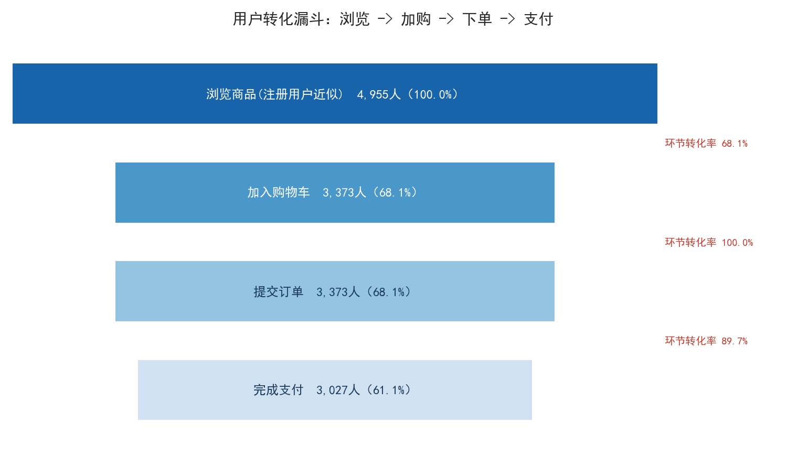
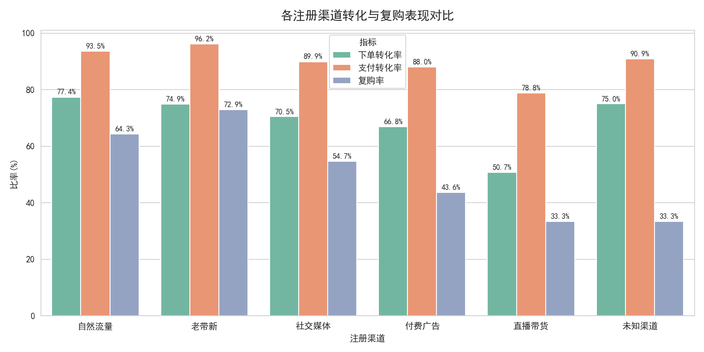

# 电商平台用户与订单综合数据分析

> 应届生数据分析实战项目 ｜ 纯业务分析，无机器学习模型 ｜ 本地可直接运行，无需外部数据集

模拟某电商平台 2024-01 ~ 2025-06 的 **5,000 名用户 + 8,000 笔订单**（含缺失值、重复订单、金额异常、无效时间等真实脏数据），完成 **数据清洗 → 指标体系 → 转化漏斗 → 用户分群 → 品类分析 → 复购画像** 全链路分析，配套 MySQL 分析 SQL、Streamlit 交互看板与完整分析报告。

## 技术栈

Python（pandas / numpy / matplotlib / seaborn）· MySQL 8.0（窗口函数 / CTE / cohort 留存）· Streamlit

## 核心结论速览

| 指标 | 数值 | 关键发现 |
|---|---|---|
| GMV | 155.3 万元 | 18.3% 高消费用户贡献 72.9% GMV（二八法则） |
| 转化漏斗 | 注册→首单流失 31.9% | 全链路最大卡点，集中在直播渠道 |
| 渠道对比 | 老带新复购率 72.9% / 客单价 760 元 | 直播带货四项指标垫底（复购仅 33.3%），建议预算再分配 |
| 复购率 | 55.0%（30 天留存 37.5%） | 首单后 30 天是复购黄金窗口 |
| 品类结构 | 数码家电贡献 47.2% 销售额 | 食品生鲜订单量第一，是复购发动机品类 |




更多图表与明细数据见 [output/](output/) 目录，完整结论与业务建议见 [analysis_report.md](analysis_report.md)。

## 文件结构

```
├─ data_process.py        # 一键脚本：生成模拟数据 → 清洗 → 分析 → 出图
├─ mysql_analysis.sql     # MySQL 分析脚本：建表/导入 + 指标/漏斗/分群/品类/留存/画像 10+ 段 SQL
├─ streamlit_dash.py      # Streamlit 交互看板（渠道/等级/品类动态筛选）
├─ analysis_report.md     # 分析报告：背景、清洗日志、结论、落地建议
├─ resume_interview.md    # 简历项目文本 + 21 道面试高频问答
├─ user_info.csv / order_info.csv    # 原始模拟数据（含脏数据）
├─ clean_user.csv / clean_order.csv  # 清洗后数据（含衍生字段）
└─ output/                # 分析结果表（12 张 csv）与可视化图表（5 张 png）
```

## 快速开始

```bash
pip install pandas numpy matplotlib seaborn streamlit   # Python 3.9+

python data_process.py                    # 一键重跑全流程（固定随机种子，结果可复现）
python -m streamlit run streamlit_dash.py # 启动交互看板 http://localhost:8501
```

MySQL 分析：先执行 `mysql_analysis.sql` 中的建表与 `LOAD DATA` 导入语句，再按需运行各分析查询（需 MySQL 8.0+，开启 `local_infile`）。

## 数据清洗覆盖的脏数据类型

重复记录（按 ID 去重）· 缺失值（金额按品类中位数填充 / 维度填未知 / 无法归属则剔除）· 金额异常（负数、0 元、超万元剔除）· 无效时间（多格式解析，非法值剔除）· 格式不规范（支付状态/标记字段归一化）· 逻辑异常（孤儿订单、下单早于注册剔除）

清洗日志：5,030 用户 → 4,955；8,210 订单 → 7,699。详见 [output/tables/clean_log.csv](output/tables/clean_log.csv)。
