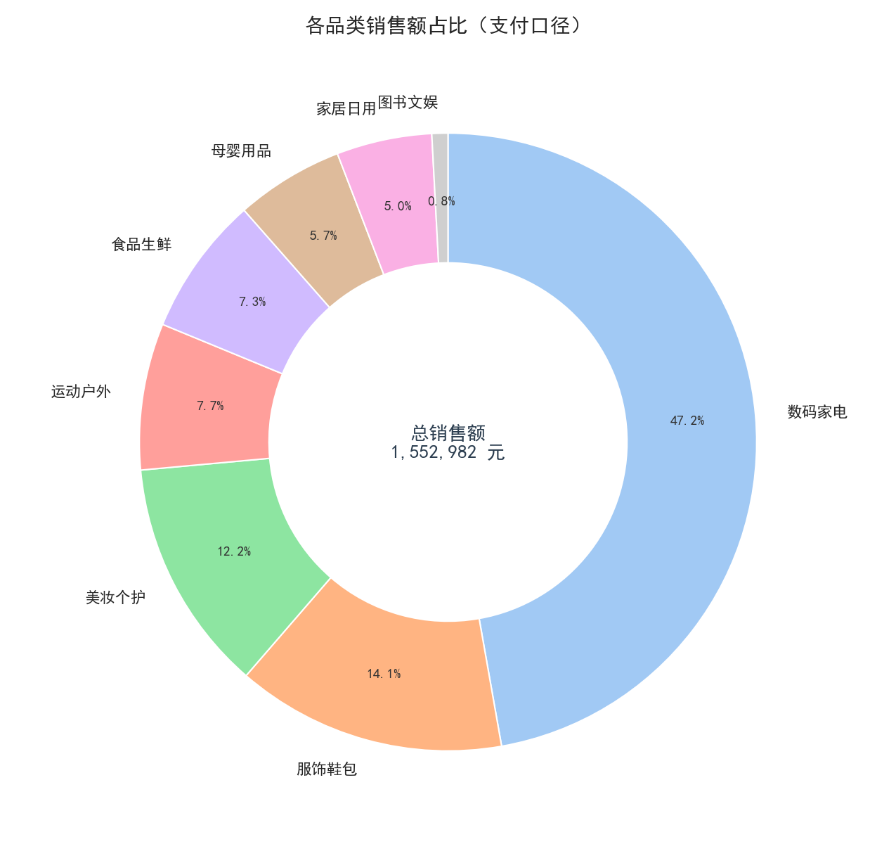
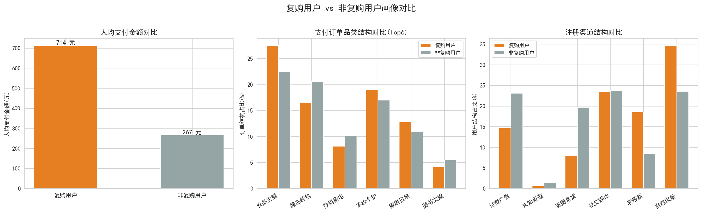

# 电商平台用户与订单综合数据分析报告

> 分析周期：2024-01-01 ~ 2025-06-30 ｜ 数据体量：用户 5,000 条 + 订单 8,000 条（含脏数据）
> 技术栈：Python（pandas / numpy / matplotlib / seaborn）+ MySQL + Streamlit
> 项目文件：`data_process.py`（清洗与分析）、`mysql_analysis.sql`（SQL 分析）、`streamlit_dash.py`（可视化看板）

---

## 一、项目背景与目标

某电商平台上线一年半，积累了 5,000 名注册用户与 8,000 笔订单。运营侧面临三个核心问题：

1. **流量贵、渠道多**：自然流量、付费广告、社交媒体、直播带货、老带新五路拉新，哪些渠道"值得投"？
2. **转化链路长**：从浏览 → 加购 → 下单 → 支付，用户主要流失在哪一环？
3. **复购不稳定**：新用户首单之后如何留住？高复购用户长什么样？

本项目目标：基于清洗后的用户/订单数据，产出**核心经营指标、转化漏斗、分群对比、品类结构、复购用户画像**五个模块的结论，并给出可落地的运营优化建议。

## 二、数据说明与清洗过程

### 2.1 数据结构

| 数据表 | 字段 | 原始条数 |
|---|---|---|
| user_info.csv | user_id、注册时间、用户等级、注册渠道、是否复购用户 | 5,030（含 30 条重复导入） |
| order_info.csv | order_id、user_id、下单时间、支付状态、商品品类、订单金额、加购标记、是否支付 | 8,210（含 150 条重复订单、60 笔孤儿订单） |

原始数据中人为注入了真实业务常见的脏数据：**缺失值、重复记录、金额异常（负数/0元/超万元）、无效时间（不存在的日期/非法字符串）、格式不规范（大小写/英文/多空格支付状态、中文字符型标记）、孤儿订单（user_id 不在用户表）**。

### 2.2 清洗规则与处理量（详见 output/tables/clean_log.csv）

| 清洗步骤 | 处理行数 | 规则说明 |
|---|---|---|
| 用户表去重 | 30 | 按 user_id 去重，保留首条 |
| 无效注册时间剔除 | 45 | 多格式解析失败或晚于统计截止日（未来时间） |
| 渠道/等级脏值填充 | 44 + 39 | 别名归一（social→社交媒体），无法识别填"未知渠道/未知等级" |
| 订单表去重 | 150 | 按 order_id 去重，保留首条 |
| 用户ID缺失剔除 | 70 | 订单无法归属用户，直接剔除 |
| 无效下单时间剔除 | 80 | 解析失败或超出统计期 |
| 金额缺失填充 | 106 | 按同品类订单金额中位数填充（保留订单、减少信息损失） |
| 金额异常剔除 | 75 | 剔除金额 ≤4 元或 >10,000 元的异常订单 |
| 支付状态归一化 | 40 | paid/SUCCESS/成功 → 已支付；pending → 未支付 等统一映射 |
| 孤儿订单剔除 | 136 | user_id 不在用户表中 |

**清洗结果：用户 5,030 → 4,955 条；订单 8,210 → 7,699 条。** 是否复购、是否支付等标记字段全部基于清洗后订单重算，保证口径一致。

### 2.3 指标口径约定

- **GMV** = 统计期内已支付订单金额合计
- **支付转化率（订单级）** = 支付订单量 / 总订单量；**（用户级）** = 支付用户数 / 下单用户数
- **客单价** = GMV / 支付用户数（人数口径）
- **复购用户** = 已支付订单数 ≥ 2 的用户；**复购率** = 复购用户数 / 支付用户数
- **新用户 30 天留存** = 首次支付后 30 天内再次支付的用户占比

## 三、核心指标总览

| 指标 | 数值 | 说明 |
|---|---|---|
| GMV | **1,552,982 元** | 已支付订单金额合计 |
| 总订单量 | 7,699 笔（支付 6,167 笔） | 订单级支付转化率 **80.10%** |
| 注册用户数 | 4,955 人 | 下单用户 3,373（68.07%） |
| 支付用户数 | 3,027 人 | 用户级支付转化率 **89.74%** |
| 客单价 | **513.04 元** | 笔单价 251.82 元 |
| 复购率 | **55.00%**（1,665 人） | 支付两次及以上用户占比 |
| 新用户 30 天留存率 | **37.50%** | 首付后 30 天内再次支付 |

**解读**：支付环节承接能力较强（下单用户近九成完成支付），但**注册 → 首单环节流失近 1/3（31.93%）**，是全局最大卡点；约 62.5% 的首单用户在 30 天内没有再回来，复购仍有明显提升空间。

## 四、转化漏斗分析

```
浏览商品(注册用户近似)  4,955 人  100.00%
    └─ 环节转化率 68.07%
加入购物车 / 提交订单   3,373 人   68.07%
    └─ 环节转化率 89.74%
完成支付               3,027 人   61.09%
```


- **卡点定位①（注册 → 首单，流失 31.93%）**：全链路最大流失点。分渠道看（见 5.1），直播带货该环节流失近一半。
- **卡点定位②（下单 → 支付，流失 10.26%）**：346 名用户下单后未支付，属于"临门一脚"型流失，可通过催付与支付体验优化回收。
- **口径说明**：数据集无独立浏览/加购行为日志，加购标记挂在订单上（加购用户 ≥ 下单用户），因此"加购 → 下单"环节转化率接近 100%，该环节真实流失需接入行为埋点后才能度量。

## 五、用户分群分析

### 5.1 注册渠道分群（核心结论）

| 注册渠道 | 用户数 | 下单转化率 | 支付转化率 | 复购率 | 客单价(元) | GMV(元) |
|---|---|---|---|---|---|---|
| 自然流量 | 1,242 | **77.38%** | 93.55% | 64.29% | 549.70 | 494,181 |
| 老带新 | 589 | 74.87% | **96.15%** | **72.88%** | **760.22** | 322,333 |
| 社交媒体 | 1,125 | 70.49% | 89.91% | 54.70% | 437.43 | 311,887 |
| 付费广告 | 950 | 66.84% | 88.03% | 43.65% | 534.06 | 298,540 |
| 直播带货 | 1,005 | **50.75%** | **78.82%** | **33.33%** | **288.28** | **115,888** |


- **老带新是"质量之王"**：客单价（760 元）、支付转化率（96.15%）、复购率（72.88%）三项全场最高，且下单未支付率仅 3.85%——熟人信任背书带来高质量用户，应重点加码。
- **直播带货是"虚胖渠道"**：拉新规模第二（1,005 人），但下单转化率、支付转化率、复购率、客单价四项全面垫底，GMV 贡献仅 7.5%——典型冲动消费、承接不足。
- **付费广告"一锤子买卖"**：客单价不低（534 元）但复购率仅 43.65%，拉来的是"买一次就走"的用户。

### 5.2 新老用户对比（以 2025-01-01 注册为界）

| 用户分层 | 用户数 | 下单转化率 | 支付转化率 | 复购率 | 客单价(元) | GMV(元) |
|---|---|---|---|---|---|---|
| 老用户(2024年注册) | 3,265 | 68.12% | 89.88% | 54.38% | 524.64 | 1,048,763（67.5%） |
| 新用户(2025年注册) | 1,690 | 67.99% | 89.47% | 56.23% | 490.49 | 504,219（32.5%） |

新用户转化略弱、客单价低约 6.5%，主因是 2025 年起直播带货投放放量、渠道结构变差；复购率持平略升，说明平台后链路承接尚可，问题主要出在**前端拉新质量**。

### 5.3 消费分层（按累计支付金额 30%/70% 分位）

| 消费分层 | 用户数 | 复购率 | 客单价(元) | GMV(元) | GMV占比 |
|---|---|---|---|---|---|
| 高消费 | 908（18.3%） | **83.26%** | 1,246.56 | 1,131,878 | **72.9%** |
| 中消费 | 1,211（24.4%） | 64.24% | 280.79 | 340,037 | 21.9% |
| 低消费 | 908（18.3%） | **14.43%** | 89.28 | 81,067 | 5.2% |

符合"二八法则"：**18.3% 的高消费用户贡献了 72.9% 的 GMV**；低消费用户复购率仅 14.43%，是"提频促活"的首要人群。

## 六、品类分析

| 商品品类 | 订单量 | 销售额(元) | 销售额占比 | 笔单价(元) |
|---|---|---|---|---|
| 数码家电 | 675 | 733,320 | **47.22%** | 1,381.02 |
| 服饰鞋包 | 1,361 | 219,442 | 14.13% | 204.32 |
| 美妆个护 | 1,408 | 189,477 | 12.20% | 165.48 |
| 运动户外 | 507 | 119,055 | 7.67% | 299.89 |
| 食品生鲜 | **2,011** | 113,266 | 7.29% | 69.53 |
| 母婴用品 | 437 | 87,835 | 5.66% | 250.24 |
| 家居日用 | 963 | 77,565 | 4.99% | 101.26 |
| 图书文娱 | 337 | 13,021 | 0.84% | 47.52 |



- **数码家电是 GMV 压舱石**：订单占比仅 8.8%，却贡献 47.2% 销售额，属"低频高值"品类，经营重点在转化与增值服务而非复购。
- **食品生鲜是复购发动机**：订单量第一（2,011 笔）、笔单价最低（69.5 元），且是复购用户最偏好的品类（见 7.1），是引流与促活的战略品类。
- 头部集中度高：Top3 品类贡献 73.6% 销售额，图书文娱几乎可忽略（0.8%）。

## 七、用户画像挖掘

### 7.1 高复购用户特征（复购用户 1,665 人 vs 非复购 1,362 人）



| 维度 | 复购用户 | 非复购用户 | 结论 |
|---|---|---|---|
| 人均支付订单数 | 2.89 单 | 1.00 单 | — |
| 人均支付金额 | **714 元** | 267 元 | 复购用户消费力是非复购的 **2.67 倍** |
| 渠道结构：老带新占比 | 18.6% | 8.4% | 复购用户中老带新占比高出 10 个百分点 |
| 渠道结构：自然流量占比 | 34.7% | 23.6% | 主动搜索型用户更易留存 |
| 品类偏好：食品生鲜订单占比 | 27.5% | 22.5% | 高频刚需品类是复购主场景 |
| 品类偏好：美妆个护/家居日用 | 19.0% / 12.8% | 17.0% / 11.0% | 同上，合计高出约 3.9 个百分点 |
| 品类偏好：服饰鞋包/数码家电 | 16.5% / 8.2% | 20.6% / 10.2% | 复购用户明显更少买"低频型"品类 |

**画像结论**：高复购用户 = **老带新/自然流量渠道 + 首单落在食品生鲜/美妆/家居等高频刚需品类 + 客单价适中**。"首单品类"可作为预测复购的先行信号。

### 7.2 低转化用户特征（注册未下单 1,582 人 / 下单未支付 346 人）

| 注册渠道 | 注册未下单率 | 下单未支付率 |
|---|---|---|
| 直播带货 | **49.25%** | **21.18%** |
| 付费广告 | 33.16% | 11.97% |
| 社交媒体 | 29.51% | 10.09% |
| 自然流量 | 22.62% | 6.45% |
| 老带新 | 25.13% | **3.85%** |

**结论**：低转化用户集中在**直播带货渠道**——一半用户注册后从未下单，下单用户中超两成不支付；而老带新用户即使下单，支付率高达 96%。低转化本质是**渠道流量质量**问题，而非产品支付流程问题。

## 八、新用户留存分析

按首单月份分组统计 30 天复购留存率（详见 output/tables/retention_by_month.csv）：整体 37.50%，各月稳定在 26%~40% 区间。**首单后 30 天内是复购黄金窗口**——超过 30 天未回访的用户大概率沉睡。

> 注：2025-06 留存率（45.8%）因观察期不足 30 天存在截尾偏高，解读时已剔除；2024 年初月份首单样本量较小，波动大。

## 九、业务优化建议（按优先级）

| 优先级 | 建议 | 预期效果 |
|---|---|---|
| P0 | **直播渠道"降量提质"**：整体投放预算下调约 30%，转向老带新（双端奖励加码）与自然流量 SEO/内容运营；直播用户增加"直播间专属承接券 + 24h 内首单提醒"承接动作 | 直播注册未下单率从 49.25% 压至 40% 以内，预计回收约 90 人首单 |
| P0 | **新客首单转化**：对 1,582 名注册未下单用户，发放 7 天有效新客礼包，在注册后 24h 内 push 触达，投放下单高峰时段（20:00–23:00，占订单 40%） | 首单转化率提升 2~3 个百分点 |
| P1 | **催付挽回**：对下单未支付用户（346 人）执行 15 分钟 + 2 小时两轮催付（短信/App push），数码家电等大额订单突出分期免息 | 订单级支付转化率提升 1~2 个百分点 |
| P1 | **30 天黄金窗口复购计划**：首单后第 7/15/30 天定向推送高频刚需品类券（食品生鲜/美妆/家居），把复购引导到用户已验证的偏好品类 | 30 天留存从 37.5% 提升至 45% |
| P2 | **低消费用户提频**：908 名低消费用户（复购率 14.43%）推"小额定户新客装/满减试用"，先用低价刚需品类建立消费习惯 | 低消费用户复购率提升至 25% |
| P2 | **品类策略**：食品生鲜作为长期引流+复购补贴品类；数码家电上线延保、以旧换新提升客单附加值 | GMV 结构更稳健 |
| P3 | **数据治理**：补齐 44 名"未知渠道"、39 名"未知等级"用户的埋点信息；接入加购/浏览行为日志，补全漏斗前端度量 | 支撑更精细的分析与归因 |

## 十、附录：项目文件说明与运行方式

| 文件 | 说明 |
|---|---|
| data_process.py | 一键运行：生成模拟数据 → 清洗 → 分析 → 出图（`python data_process.py`） |
| mysql_analysis.sql | 建库建表、数据导入、核心指标/漏斗/分群/品类/留存/画像共 10+ 段分析 SQL（MySQL 8.0+） |
| streamlit_dash.py | 交互式看板（`streamlit run streamlit_dash.py`），支持渠道/等级/品类筛选 |
| clean_user.csv / clean_order.csv | 清洗后数据（含衍生字段：消费分层、是否首单、下单月份等） |
| output/tables/*.csv | 全部分析结果明细表 |
| output/charts/*.png | 5 张分析图表 |

依赖：`pip install pandas numpy matplotlib seaborn streamlit`，Python 3.9+，本地可直接运行，无需外部数据集与 API。
